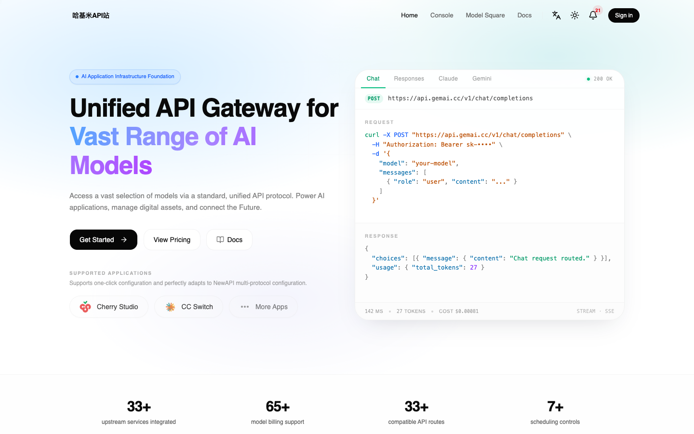
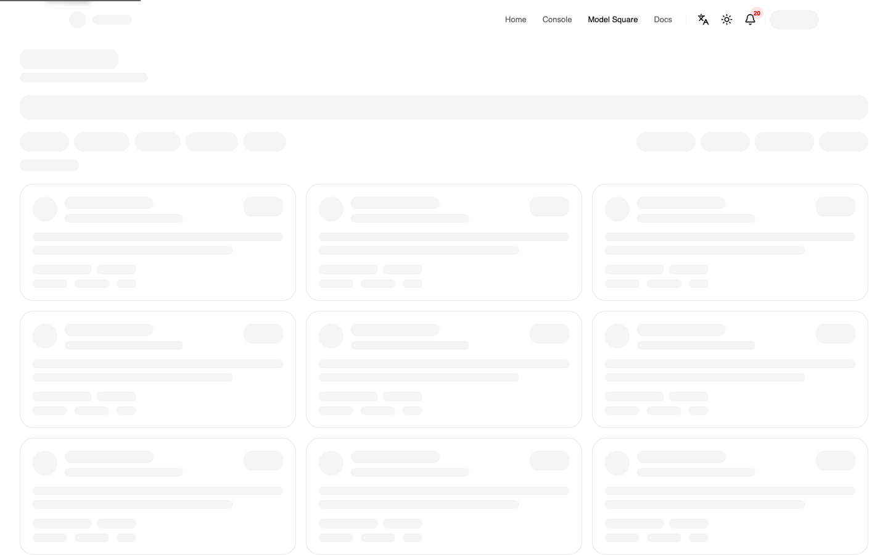
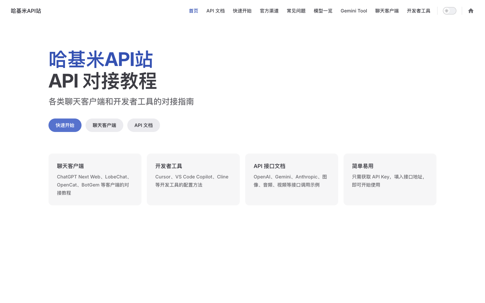

# 哈基米 API 测评：261 个模型集中在一个网关，生图与多模型调用怎么选

哈基米最吸引人的地方，不是某一个模型价格，而是**一个账户同时管理文本、图像与多协议模型**。公开模型广场当前列出 261 个模型，OpenAI、Claude、Gemini、DeepSeek 等路线可以在同一页面按供应商、标签和计费方式筛选。对于正在比较 AI 中转站的人，它更像一座选择丰富的“模型超市”。

[查看哈基米当前模型与价格](https://api.gemai.cc/sign-up?aff=KJZo)

## 哈基米值得买的三个理由

第一，模型覆盖广。首页展示统一 API 网关、50+ 上游服务、100+ 计费支持与多种路由能力，适合同时使用聊天、代码和生图模型的人。第二，价格页把模型 ID、输入价、输出价、缓存价或单次请求价放在同一张卡片里，换模型时不必重新学习另一套后台。第三，文档按 OpenAI、Claude、Gemini 等接口分区，Cherry Studio、CC Switch 一类客户端也有明确入口。

## 价格怎么看才最划算

哈基米同时存在按 Token 和按次请求两种商品。按次线路适合生图、偶尔使用的高阶模型与工作流试跑；按 Token 线路更适合日常文本、代码和批量任务。公开页面可见从较低名义单次价到高价模型的多档选择，真正省钱的方式是先确定任务，再在同一计费单位里比较。

- 日常问答、摘要：优先选择价格较低的轻量模型；
- 代码与复杂推理：选择能力更强的模型，同时限制 Key 预算；
- 生图：按单次请求价格比较，并留意一次请求生成的图片数量与尺寸规则；
- 长文本：重点比较输出价与缓存价，不能只看输入价。

## 注册、充值与创建 Key

1. 通过入口注册并登录控制台；
2. 打开钱包或充值页面，选择页面当时提供的金额与支付方式；
3. 先充值一笔能覆盖数次完整任务的金额；
4. 在令牌页面创建一把独立 Key，并设置额度；
5. 从模型广场复制精确模型 ID；
6. 在客户端填写 Base URL、Key 和模型 ID，完成第一次调用。

首次充值的目标是跑通客户端、日志和扣费，不是一次买满。确认常用模型的速度、输出和成本后，再补充余额更合理。

## 它可以替代哪些方案

如果你现在分别购买多个模型账号，哈基米可以替代“多账户、多余额、多把密钥”的管理方式；如果你使用 Claude Code、Codex、Cherry Studio 或自建应用，它可以作为统一接口层。它尤其适合需要在多个模型间切换、又希望统一看账单的人。

## 购买建议

把哈基米当成多模型采购入口，而不是只盯一个最低价模型。先选一个日常文本模型和一个核心高阶模型，分别创建限额 Key；生图任务再单独建 Key。这样既能体验 261 个模型的覆盖优势，也能把意外消耗锁在单个项目内。

## 常见问题

### 哈基米能接 Claude Code 和 Codex 吗？
文档提供多协议入口。复制对应模型 ID，按客户端所需协议填写地址和 Key 即可；两种工具使用不同 Key，账目更清楚。

### 哈基米适合生图吗？
模型广场提供图像模型和按次价格，适合把不同生图路线放在一处比较。下单前看清尺寸、张数与单次请求规则。

### 应该充多少？
先按常用模型单价准备数次完整任务的预算。完成调用并看过实际扣费后，再决定长期余额。

[进入哈基米，选择你的第一组模型](https://api.gemai.cc/sign-up?aff=KJZo)
